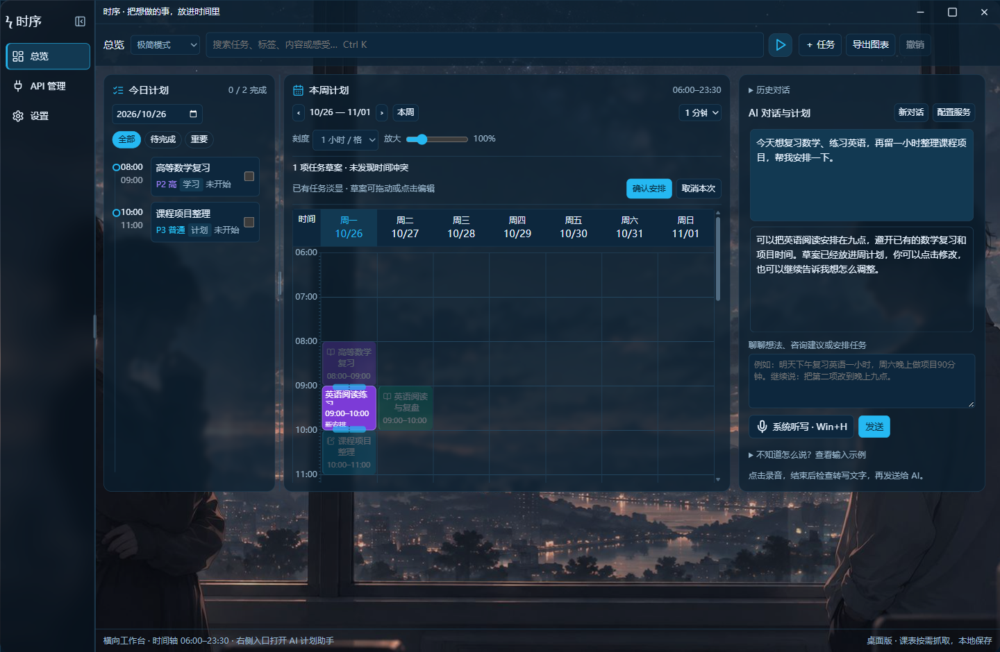
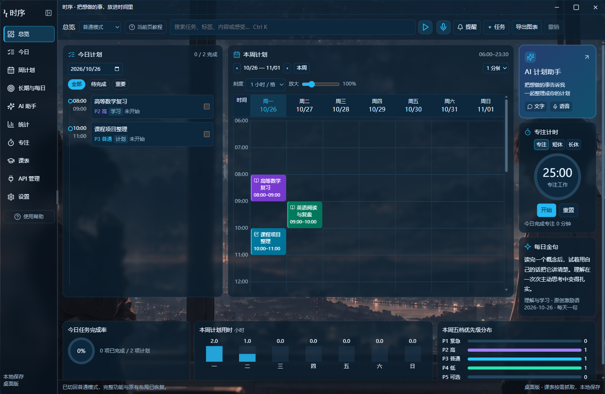

# 时序 Shixu

**把想做的事说清楚，把时间安排握在自己手里。**

时序是一款面向学习与工作的 Windows 桌面时间规划工具。你可以直接打字，也可以先用语音转成文字，让 AI 一起讨论目标、整理任务和安排时间。AI 的建议先放进时间表预览，你可以继续修改，确认后才写入日程。

[下载 Windows 版](https://github.com/WSDCERFV/shixu/releases/latest) · [快速上手](#快速上手) · [从源码运行](#从源码运行) · [反馈问题](https://github.com/WSDCERFV/shixu/issues)

## 下载与安装

当前版本：**[0.8.5](https://github.com/WSDCERFV/shixu/releases/tag/v0.8.5)**。支持 **Windows 10 / 11，x64**；其他系统尚未验证。新版包含 0.8.1–0.8.4 开发版本的改进，完整记录见 [CHANGELOG](CHANGELOG.md)。

到 [Releases](https://github.com/WSDCERFV/shixu/releases/latest) 下载：

| 文件 | 适合谁 | 如何打开 |
| --- | --- | --- |
| [Shixu-0.8.5-setup-x64.exe](https://github.com/WSDCERFV/shixu/releases/download/v0.8.5/Shixu-0.8.5-setup-x64.exe) | 希望安装并长期使用 | 双击安装，可选择安装目录 |
| [Shixu-0.8.5-preview-win-x64.zip](https://github.com/WSDCERFV/shixu/releases/download/v0.8.5/Shixu-0.8.5-preview-win-x64.zip) | 想先体验，不想安装 | 解压整个文件夹，运行“时序预览.exe” |
| [Shixu-0.8.5-source.zip](https://github.com/WSDCERFV/shixu/releases/download/v0.8.5/Shixu-0.8.5-source.zip) | 想查看、修改或构建源码 | 解压后按下方开发步骤运行 |

安装包和免安装版已包含桌面运行环境，普通使用不需要安装 Node.js。不要在压缩包里直接运行程序，也不要只拷贝其中的 exe。

目前安装包尚未代码签名，Windows 可能显示“未知发布者”。首次启动没有内置测试计划，升级安装默认保留已有个人记录。

本版可在 **设置 → 应用更新** 检查新版、查看更新内容、下载并显示进度，最后点击“保存并退出安装”覆盖升级。0.8.0 用户首次需手动覆盖安装一次，无需卸载；已经使用带更新入口的开发版本时，可直接在软件内检查新版。可选启动时检查，默认关闭；软件不会自动下载或在普通退出时自行安装。免安装预览只检查版本，通过发布页获取完整 ZIP。详见 [更新与发布](docs/UPDATES.md)。

## 界面预览

### 极简模式

当日计划、周计划、AI 对话在同一页。已有任务淡显，待确认草案突出显示，支持点击编辑和拖动调整。



### 普通模式

保留完整的日程、长期与每日计划、专注、统计、课表和设置页面。



截图使用虚构的演示安排，演示任务不会预置到用户日程。

## 快速上手

1. **选择模式**：顶部切换普通 / 极简模式。两者共用日程和配置。安装版默认普通模式，免安装预览默认极简模式。
2. **先试试时间表**：点击“＋任务”手动创建，单击查看详情；拖动调整时间，双击进入时长编辑。
3. **连接 AI**：在“API 管理”选择供应商模板，再选择模型并填写自己的 API Key；其他兼容服务可自定义地址和模型。保存后选择规划服务。软件不附赠模型服务或额度。
4. **告诉 AI 你的需求**：可以先咨询建议，也可以要求生成任务。例如：“明晚有两小时，想复习数学和英语，中间留十分钟休息，避开已有任务。”
5. **预览后再确认**：查看草案、步骤和冲突，手动修改或继续对话。点击“确认安排”后才写入；取消草案不会改变原日程。

AI 对话会自动加载 [内置规划技能](desktop/skills/shixu-planner/SKILL.md)，结合已有日程和本地时间检查生成可编辑草案。可调时间发生冲突时会尝试避让，固定时间会保留并提示；仍有冲突的 AI 草案须先调整再确认。

课程默认作为占用时间，普通排程不会顺带重排整份课表。调课请指定课程及原日期，例如“把 11 月 2 日的大学物理实验改到 14:00–15:00”；应用只允许模型处理本轮对应课程，其他课程保留。课表确认后不会在继续对话时重新成为整学期待确认任务。

默认语音使用 Windows 系统听写：点击语音按钮聚焦输入框，再按 **Win + H**。识别结果与打字共用同一个输入框。系统听写需要 Windows 支持、麦克风和网络；可选的云端转写需要另外配置兼容的转写服务。

更完整的操作说明见 [使用说明](desktop/使用说明.md) 和 [AI 服务配置](docs/AI_SERVICES.md)。

## 主要功能

| 功能 | 可以做什么 |
| --- | --- |
| 双模式 | 普通模式保留完整工作台，极简模式集中处理时间规划 |
| 当日与整周计划 | 分钟级起止时间、五档优先级、标签、拖动、时长编辑与双向选中 |
| AI 对话与草案 | 内置规划技能、空闲时段、冲突避让；发送状态、流式回复、停止与重试 |
| 任务详情 | 具体步骤、状态、创建/修改时间、标签、心得及邮件提醒；可拖动或独立到桌面 |
| 长期与每日计划 | 阶段目标、关联任务、按星期重复与单次调整 |
| 课表导入 | 其他学校 CSV / ICS 导入；东南大学账号抓取为实验性功能 |
| 提醒与专注 | 任务浮窗、轻柔提示音、番茄时钟、专注记录与可选邮件提醒 |
| 个性化 | 深浅主题、面板透明度、布局宽度、缩放与背景预览 |
| 导出 | 导出日程图表，便于保存或分享 |
| 应用更新 | 手动检查、下载进度、取消、文件校验及保留个人记录的覆盖升级 |

极简模式只保留总览、API 管理和设置三个入口；课表导入收进设置，专注与统计选项在此模式下隐藏。

## AI、数据与隐私

- 日程、偏好、对话和待确认草案保存在本机，不提供内置云同步。
- 使用 AI 时，当前需求、对话和相关日程内容会发送给**你选择的服务提供商**。任务的“我的感受”字段不会作为日程上下文自动发送。
- API Key 与 SMTP 授权码由 Windows 系统加密保存，不写入日程或回显到界面；跨电脑或跨 Windows 用户迁移后可能需要重新填写。
- 系统听写由 Windows 提供；选择云端转写时，录音会发送给对应供应商，应用不保留本地录音文件。
- 学校抓取只在你点击抓取按钮时进行。账号密码用于临时学校登录会话，应用不保存学校密码；已导入课表平时读取本地。登录后需明确选择学校返回的真实学期名称、核对第一教学周日期；暑期学期需额外确认，不会读取网页默认选中的课表。

安装版数据在 `%APPDATA%\Shixu`；缓存等在 `%LOCALAPPDATA%\Shixu`。免安装版数据在程序旁的“预览数据”文件夹，与安装版分开，暂不自动迁移。备份前先退出程序，保留完整的数据目录。

详细说明见 [数据与网络行为](docs/DATA_AND_PRIVACY.md)。提交问题或截图时，请自行隐去账号、密钥和个人日程。

## 从源码运行

开发环境：**Windows x64、Node.js 22.12 或更新版本（建议 Node.js 24）、npm、Git**。

```powershell
git clone https://github.com/WSDCERFV/shixu.git
cd shixu/desktop
npm ci
npm start
```

如果下载的是源码 ZIP，解压后进入其中的 `desktop` 目录，从 `npm ci` 开始即可，不用再次克隆仓库。

首次安装依赖需要下载 Electron 运行环境。如果安装脚本未执行，或提示找不到 Electron，可在 `desktop` 目录运行：

```powershell
node node_modules/electron/install.js
```

界面源文件为 `desktop/ui-source.html`。启动与构建会从它生成离线界面，不依赖作者电脑上的路径，也不需要 Codex。生成的 `renderer.html`、`native-detail.html`、`lucide.js` 不提交到仓库。

开发时建议使用独立数据目录，以免碰到自己日常使用的记录：

```powershell
$env:SHIXU_DATA_DIR = Join-Path $env:TEMP 'shixu-development'
npm start
```

## 测试与打包

以下命令均在 `desktop` 目录运行：

```powershell
npm test                 # 单元测试
npm run test:desktop     # Windows 桌面回归检查，会打开测试窗口
npm run dist             # 生成 x64 安装程序
npm run package:preview  # 生成免安装预览文件夹
```

打包产物写入仓库根目录的 `outputs/`。不要把该目录或个人预览数据提交为源码；供用户下载的文件发布到 Releases。构建工具首次下载可能需要较长时间，开发细节见 [开发与构建](docs/DEVELOPMENT.md)。

当前回归检查覆盖持久化、草案确认与取消、并发手动修改保护、独立详情、模式切换、重启恢复、流式生成/取消、延迟登录表单和学期选择，以及更新下载、取消、校验和保存失败。测试使用隔离目录、本地更新服务器和模拟 AI 服务；不会执行真实升级，未用真实学生账号、外部模型密钥或 QQ 邮箱验证实际服务质量与送达。

## 当前限制

- 应用退出或电脑休眠期间，不会发送任务或邮件提醒；开机启动是可选项，默认关闭。
- 自定义上传背景目前只在当前打开期间有效。
- 东南大学登录抓取尚未用真实学生账号完成端到端验证，网站改动、校园网/VPN 或验证码可能影响使用。可改用文件导入。
- AI 需要自行配置兼容服务，服务商可能收费；输出质量和识别质量由所选服务决定，请检查后再确认。
- Windows 以外的平台、安装包代码签名和内置云同步尚未提供。

## 反馈与贡献

欢迎在 [Issues](https://github.com/WSDCERFV/shixu/issues) 报告问题或提出建议。请说明版本、Windows 版本、使用模式、操作步骤，以及预期与实际结果。

提交修改前请阅读 [贡献说明](CONTRIBUTING.md)，先运行相关测试。请勿提交真实账号密码、API Key、SMTP 授权码或个人数据。

## 许可证与致谢

项目采用 [MIT License](LICENSE)，允许使用、修改和再分发，需保留版权及许可声明。第三方组件及其许可见 [THIRD_PARTY_NOTICES.md](THIRD_PARTY_NOTICES.md)。

主要使用 Electron、Lucide、Nodemailer、electron-builder 和 Playwright。内置背景是为本项目制作的生成插画，参考截图和个人资料不随源码分发。感谢所有提供反馈、报告问题和参与改进的人。
